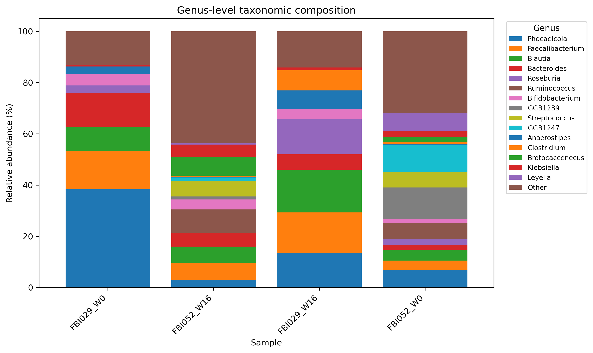
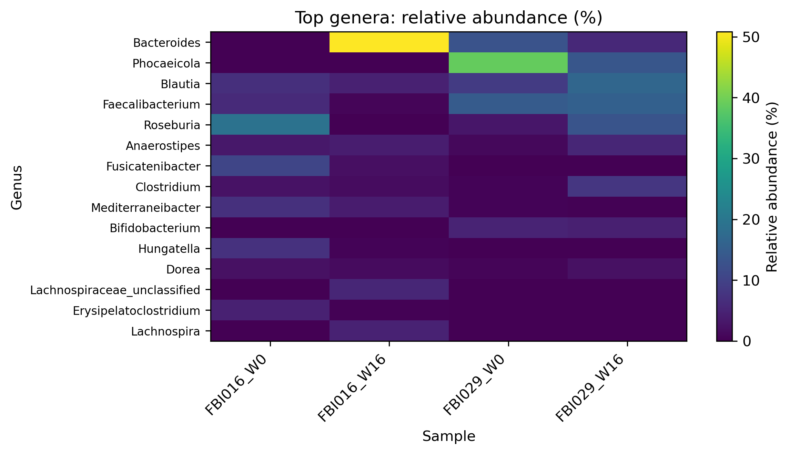
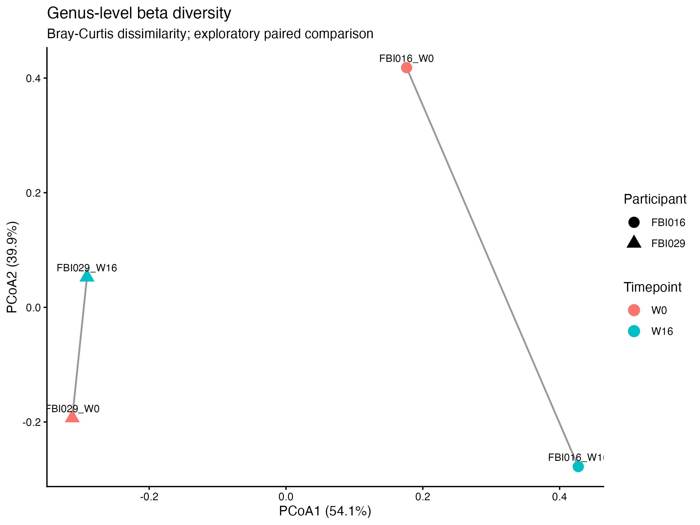

# Gut Microbiome Shotgun Metagenomics

Reproducible **shotgun metagenomics workflow** developed in **Nextflow DSL2** to investigate gut microbiome changes associated with a legume-enriched diet in a randomized controlled trial of adults with prediabetes.

The project is being developed incrementally, with each analysis step incorporated into the workflow and documented here. The main focus is on reproducible workflow development, biological reasoning and transparent documentation of analytical decisions.


## Workflow architecture

The project is organized into two stages:

- **Part I — Quality control and taxonomic profiling (`main_I.nf`):** processes paired-end FASTQ files through raw-read quality control with FastQC and MultiQC, adapter trimming with Cutadapt, post-trimming quality control, read subsampling, taxonomic profiling with MetaPhlAn, profile merging, and taxonomic summary visualization.

- **Part II — Functional profiling (`main_II.nf`, in development):** will extend the workflow with HUMAnN to characterize microbial gene families and metabolic pathways. In progress.

---

## 1. Study background

This project uses publicly available data from the randomized controlled trial:

**A legume-enriched diet improves metabolic health in prediabetes mediated through gut microbiome: a randomized controlled trial**

* **NCBI BioProject:** `PRJNA1201249`
* **Study population:** adults with prediabetes
* **Intervention:** legume-enriched diet
* **Sample type:** fecal microbiome
* **Sequencing:** shotgun metagenomic sequencing
* **Platform:** Illumina NovaSeq 6000
* **Study duration:** 16 weeks
* **Sampling:** W0, W2, W4, W8, W12 and W16

The published study investigated changes in the gut microbiome together with metabolic and other biological measurements.

For this portfolio project, a smaller **paired longitudinal subset** was selected to develop and demonstrate a reproducible shotgun metagenomics workflow. The selected samples represent two participants with measurements at baseline (W0) and week 16 (W16).

---

## 2. Biological question

> **How does the gut microbiome change between baseline and week 16 in participants undergoing different dietary interventions in this randomized controlled trial?**

The analysis focuses on paired samples from the same participants at W0 and W16. This provides a simple longitudinal framework for exploring changes in microbial composition and function while keeping the participant as the reference unit.

The project is intended as a **portfolio-scale reproducible analysis**, rather than a complete reanalysis of the original clinical trial.

---

## 3. Samples

| Sample     | Participant | Group  | Timepoint | SRA run     |
| ---------- | ----------- | ------ | --------- | ----------- |
| FBI029_W0  | FBI029      | Group1 | W0        | SRR31800610 |
| FBI029_W16 | FBI029      | Group1 | W16       | SRR31800159 |
| FBI016_W0  | FBI016      | Group2 | W0        | SRR31800340 |
| FBI016_W16 | FBI016      | Group2 | W16       | SRR31800133 |

Metadata: sample sheet/samples.tsv

The complete sample metadata used during project preparation are stored in: samplesheet/shotgun_metadata.tsv

---

## 4. Analysis workflow

The workflow is being developed incrementally. The current planned analysis is:

```text
Raw paired-end FASTQ
        │
        ▼
      FastQC
        │
        ▼
      MultiQC
        │
        ▼
     Cutadapt
        │
        ▼
 Trimmed FASTQ
        │
        ├── FastQC
        │
        └── MultiQC
                │
                ▼
            MetaPhlAn
                │
                ▼
        Taxonomic profiling
                │
                ▼
             HUMAnN
                │
                ▼
       Functional profiling
                │
                ▼
       Downstream analysis
```

Each stage is implemented as a reproducible Nextflow component and added to the workflow as the analysis progresses.

### Download FASTQ files from SRA

FASTQ files are downloaded from the NCBI Sequence Read Archive (SRA) using `prefetch` and `fasterq-dump`. The script processes samples sequentially, validates the paired-end FASTQ files, and skips samples that have already been downloaded and validated.

Run the download script from the project root:

```bash
mkdir -p reports
python3 scripts/download_fastq.py --threads 2 2>&1 | tee reports/download_report.txt
```

**Command explanation:**
- `--threads 2`: uses two threads for FASTQ extraction.
- `2>&1`: redirects standard error to standard output, capturing both regular messages and errors.
- `tee reports/download_report.txt`: displays the output in the terminal and saves a copy to a text report.

**Output:**
- `data/raw/`: downloaded and validated paired-end FASTQ files.
- `reports/download_report.txt`: execution log, including download progress, skipped samples, validation messages, and the final summary.

The script uses an external drive for the SRA cache and temporary files to reduce storage pressure on the local machine. The external drive must be mounted before execution.

The report documents the output of each execution; running the command again overwrites the previous `download_report.txt` file.


Step-by-step analysis

Step 1 — Raw read quality control

Input: Raw paired-end shotgun metagenomic FASTQ files

The raw sequencing reads were assessed before preprocessing to evaluate sequencing quality and identify potential issues.

Tool: FastQC

FastQC was run automatically through Nextflow for all four selected biological samples, generating reports for both R1 and R2.

Output: FastQC reports

Files: results/fastqc/

Step 2 — Quality control - MultiQC

The individual FastQC reports were aggregated with MultiQC to provide a global overview of raw-read quality across the dataset.

MultiQC was implemented as a reusable Nextflow module and uses the existing FastQC .zip reports as input.

Output: results/multiqc/multiqc_report.html

## 3. Adapter identification

Before adapter trimming, the adapter sequences were identified from the sequencing data rather than assumed from the sequencing platform alone.

The study used paired-end Illumina NovaSeq 6000 sequencing. FastQC detected low-level adapter contamination in the raw reads. To investigate the adapter sequences, the expected Illumina adapter sequences were searched directly in the FASTQ files.

The following sequences were detected in the selected sample (`FBI029_W0`):

| Read | Adapter sequence                    | Matches |
| ---- | ----------------------------------- | ------: |
| R1   | `AGATCGGAAGAGCACACGTCTGAACTCCAGTCA` |   7,477 |
| R2   | `AGATCGGAAGAGCGTCGTGTAGGGAAAGAGTGT` |   7,532 |

The presence of these sequences in both reads supports their use as the adapter sequences for the paired-end trimming step with Cutadapt.

This provides a data-supported basis for the adapter configuration used in the next workflow step.

### 4. Adapter trimming

The identified adapter sequences were removed from the paired-end reads using Cutadapt.
Cutadapt was implemented as a reusable Nextflow module and processes all samples automatically.
A JSON report was generated for each sample to retain the trimming statistics.

Input: file_1.fastq.gz file_2.fastq.gz
Output: results/trimmed/

A summary table was generated automatically from the Cutadapt reports:
Output: results/trimmed/cutadapt_summary.tsv

The trimming step was completed successfully for all four paired-end samples. Adapter sequences were detected in approximately 2.4–2.8% of reads, while the majority of reads did not contain detectable adapter sequence.

| Sample     | Input reads | R1 adapter reads (%) | R2 adapter reads (%) |
| ---------- | ----------: | -------------------: | -------------------: |
| FBI029_W0  |  24,354,291 |      596,811 (2.45%) |      583,191 (2.39%) |
| FBI029_W16 |  23,684,666 |      667,974 (2.82%) |      645,015 (2.72%) |
| FBI016_W0  |  24,815,969 |      721,920 (2.91%) |      697,592 (2.81%) |
| FBI016_W16 |  25,160,519 |      884,940 (3.52%) |      878,403 (3.49%) |


## 5. Quality control after trimming

FastQC was run again on the trimmed reads to assess read quality after adapter removal.
The FastQC results were aggregated with MultiQC to provide a global overview of the processed reads.

Both steps were implemented as reusable Nextflow modules.

Output: results/fastqc_trimmed/

Output: results/multiqc_trimmed/multiqc_report.html

The post-trimming QC was used to verify that the processed reads were suitable for downstream taxonomic profiling.

## 6. Read subsampling for taxonomic profiling

A subset of the trimmed reads was generated before taxonomic profiling to enable an efficient local benchmark with MetaPhlAn.

Because the complete dataset contains approximately 24 million paired-end reads per sample, a full MetaPhlAn mapping run was computationally demanding on the local system. A subset of 1 million paired reads per sample was therefore selected for this portfolio-scale analysis.

Subsampling was implemented as a reusable Nextflow module using `seqtk`. The same random seed (`42`) was used for R1 and R2 to maintain paired-end correspondence.

Input: `results/trimmed/<sample>_trimmed_1.fastq.gz`  
       `results/trimmed/<sample>_trimmed_2.fastq.gz`

Output: `results/subsampled/<sample>_subsampled_1.fastq.gz`  
        `results/subsampled/<sample>_subsampled_2.fastq.gz`

The subsampling process was applied automatically to all four samples.

The 1 million-read subset was used as a computational benchmark for downstream taxonomic profiling rather than as a replacement for the complete sequencing depth.

## 7. Taxonomic profiling with MetaPhlAn

MetaPhlAn was used to estimate the taxonomic composition of the shotgun metagenomic samples from the subsampled paired-end reads.

The `METAPHLAN` module runs MetaPhlAn offline using the configured database and index. It processes paired-end reads together and uses the `metaphlan_db`, `metaphlan_index`, and `metaphlan_threads` parameters defined in the local `nextflow.config`.

**Input:**
- `results/subsampled/<sample>_subsampled_1.fastq.gz`
- `results/subsampled/<sample>_subsampled_2.fastq.gz`

**Output:**
- `results/metaphlan/<sample>_profile.txt` — individual taxonomic profile for each sample.
- `results/metaphlan/<sample>_mapout.bz2` — MetaPhlAn mapping output for each sample.

## 7.1 Taxonomic profiling merge 

The profiling step is followed by the `METAPHLAN_MERGE` module, which combines the individual taxonomic profiles into a single table using `merge_metaphlan_tables.py`. This merged table is then used as input for the downstream taxonomic summary and beta diversity analyses.

The separation between profiling and merging allows existing profiles to be reused, avoiding unnecessary reruns of the computationally intensive profiling step.

**Input:**
- `results/metaphlan/<sample>_profiles.txt

**Output:**
- `results/metaphlan/metaphlan_merge.tsv


## 8. Genus-level taxonomic summary and visualization

The merged MetaPhlAn table is passed directly to the `TAXONOMY_SUMMARY` module, defined in `modules/taxonomy_summary/main_taxonomy_summary.nf`.

This module executes the Python script `scripts/taxonomy_summary.py`, which extracts genus-level entries from the merged table and summarizes their relative abundances across samples. Restricting the summary to genus-level entries avoids mixing different taxonomic ranks in the same visualization.

The analysis generates three outputs:

* `results/taxonomy_summary/taxonomy_summary.tsv`: genus-level relative abundance table.
* `results/taxonomy_summary/taxonomy_barplot.png`: stacked bar plot showing the 15 genera with the highest mean relative abundance across samples. The remaining genera are grouped as `Other`.
* `results/taxonomy_summary/taxonomy_heatmap.png`: heatmap comparing the relative abundances of the same 15 genera across samples.

### Genus-level taxonomic composition

The stacked bar plot provides an overview of the relative contribution of the most abundant genera in each sample.



### Comparison of the most abundant genera

The heatmap complements the bar plot by highlighting differences in the relative abundance patterns of the selected genera across samples.



These visualizations provide an exploratory overview of microbial community composition and can help identify taxa for further investigation.

The current analysis includes four samples: `FBI029_W0`, `FBI029_W16`, `FBI016_W0`, and `FBI016_W16`. Comparisons between baseline (W0) and week 16 (W16) are descriptive and exploratory. 


## 9. Beta diversity analysis and PCoA visualization

Beta diversity is used to explore differences in microbial community composition between samples. In this workflow, genus-level relative abundance profiles derived from MetaPhlAn are used to calculate Bray–Curtis dissimilarities and perform Principal Coordinates Analysis (PCoA).

The `BETA_DIVERSITY` module, defined in `modules/taxonomy_summary/main_beta_diversity.nf`, uses the genus-level abundance table generated by `TAXONOMY_SUMMARY`. The analysis normalizes the abundance profiles to relative abundances, calculates pairwise Bray–Curtis dissimilarities, and projects the samples into a two-dimensional ordination space using PCoA.

The analysis generates three outputs:

* `results/beta_diversity/bray_curtis_distance.tsv`: pairwise Bray–Curtis dissimilarity matrix between samples.
* `results/beta_diversity/pcoa_coordinates.tsv`: PCoA coordinates for each sample, including participant and timepoint metadata.
* `results/beta_diversity/pcoa_bray_curtis.png`: PCoA plot showing sample relationships based on genus-level microbial composition.

### Beta diversity: Bray–Curtis PCoA

The PCoA visualization provides an exploratory overview of similarities and differences in microbial community composition. Samples closer together in the ordination should have more similar genus-level abundance profiles, whereas samples farther apart are more dissimilar. Lines connect baseline (W0) and week 16 (W16) samples from the same participant to facilitate visual comparison of within-participant changes.



The analysis includes four samples from two participants: `FBI016_W0`, `FBI016_W16`, `FBI029_W0`, and `FBI029_W16`. Given the small sample size, the ordination is interpreted descriptively and does not provide statistical evidence that the dietary intervention caused changes in microbial community composition.

## 10. Functional profiling with HUMAnN

HUMAnN was used to estimate the functional potential of the shotgun metagenomic samples from the subsampled paired-end reads, using the corresponding MetaPhlAn taxonomic profiles.

The `HUMANN` process, defined in `modules/humann/main_humann.nf` and executed through `main_II.nf`.

**Input:** `results/subsampled/*_{1,2}.fastq.gz` and corresponding MetaPhlAn profiles from `results/metaphlan/<sample>_profile.txt`.
**Output:** `results/humann/<sample>_humann/`, containing the gene family abundance, pathway abundance, and pathway coverage tables for each sample. 

Output files for each sample: 

* `*_genefamilies.tsv`: estimated gene family abundances.
* `*_pathabundance.tsv`: estimated metabolic pathway abundances.
* `*_pathcoverage.tsv`: pathway coverage estimates.

## 10.1 Functional profiling merge

After functional profiling, the HUMANN_MERGE module combines the individual HUMAnN output tables into merged tables for downstream comparative analysis.

The module merges gene family abundance and pathway abundance tables across all samples, allowing functional features and metabolic pathways to be compared between participants and timepoints.

Input:

Individual *_genefamilies.tsv files from results/humann/<sample>_humann/
Individual *_pathabundance.tsv files from results/humann/<sample>_humann/

Output:

results/humann/humann_merge/genefamilies_merged.tsv
results/humann/humann_merge/pathabundance_merged.tsv

The merged tables provide a unified view of functional gene families and metabolic pathway abundances across the four samples.

### 10.2 Functional profile summary and visualization

Following functional profile merging, a custom Python script (`scripts/humann_summary.py`) summarizes the merged HUMAnN pathway abundance table and generates visualizations of the 15 pathways with the highest mean abundance across samples.

This step provides a compact overview of predicted microbial functional profiles and facilitates exploratory comparisons between participants and timepoints.

**Input:**
- `results/humann/humann_merge/pathabundance_merged.tsv`

**Outputs:**
- `results/humann/humann_summary/pathabundance_summary.tsv` — filtered pathway abundance table used for downstream visualization.
- `results/humann/humann_summary/top15_pathways.png` — horizontal bar plot of the 15 pathways with the highest mean abundance across samples.
- `results/humann/humann_summary/top15_pathways_heatmap.png` — heatmap showing the abundance patterns of these pathways across samples.

**Top 15 pathways by mean abundance**


**Pathway abundance heatmap**


These visualizations support the interpretation of predicted microbial functional potential and help identify pathways for further investigation. Results are exploratory and do not, by themselves, demonstrate pathway activity or metabolic function in vivo.


### 10.3 Longitudinal taxonomic and functional analysis

A custom Python script (`scripts/longitudinal_analysis.py`) was developed to perform a descriptive longitudinal comparison of microbial taxonomic composition and functional pathway abundance between baseline (W0) and week 16 (W16) for each participant.

The analysis compares paired samples from two participants (FBI016 and FBI029) to explore individual changes over time. The script also normalizes HUMAnN pathway abundance profiles to counts per million (CPM) as part of the functional analysis.

**Inputs:**
- `results/taxonomy_summary/taxonomy_summary.tsv` — genus-level abundance table generated from MetaPhlAn profiles.
- `results/humann/pathabundance_merged.tsv` — merged HUMAnN pathway abundance table.

**Outputs:**
- `results/humann/pathabundance_cpm.tsv` — HUMAnN pathway abundance table normalized to CPM.
- `results/longitudinal/taxonomy_abundances.tsv` — genus-level abundance table used for longitudinal analysis.
- `results/longitudinal/taxonomy_changes.tsv` — paired W0 and W16 abundances, absolute differences, and log2 fold changes where defined for each genus and participant.
- `results/longitudinal/taxonomy_paired_changes.png` — paired line plots showing genus abundance across timepoints.

These analyses are exploratory and descriptive. With only two participants, they do not establish statistical significance or a causal effect of the dietary intervention. HUMAnN pathway abundances represent inferred microbial functional potential rather than direct measurements of metabolic activity in vivo.


## Reference databases

### MetaPhlAn

- **Version:** 4.1.1
- **Database index:** `mpa_vJun23_CHOCOPhlAnSGB_202403`
- **Purpose:** Taxonomic profiling of shotgun metagenomic reads.
- **Storage:** External to the Git repository.
- **Configuration:** Database paths and index are defined in the local Nextflow configuration.

### HUMAnN

| Database | Purpose | Storage |
|---|---|---|
| ChocoPhlAn (full) | Nucleotide-level search against microbial pangenomes | External storage |
| UniRef50 (full annotated) | Protein-level search and functional annotation | External storage |

Example local configuration:

```groovy
params {
    metaphlan_db = '/path/to/metaphlan_database_humann'
    metaphlan_index = 'mpa_vJun23_CHOCOPhlAnSGB_202403'

    humann_chocophlan_db = '/path/to/humann_database/chocophlan'
    humann_uniref_db = '/path/to/humann_database/uniref'
}
```

Replace the example paths with the database locations available in your environment. Keep machine-specific configuration files out of version control.

## Storage and reproducibility

- Keep reference databases and raw FASTQ files outside the Git repository.
- Exclude large intermediate files and temporary workflow outputs from version control.
- Define machine-specific paths in local configuration files rather than hard-coding them in workflow modules.
- Ensure sufficient storage for databases, input data, intermediate files, and final outputs.
- Record software versions and database releases to support reproducibility.

**Analysis environment:** The workflow was configured to use MetaPhlAn 4.1.1 with database index `mpa_vJun23_CHOCOPhlAnSGB_202403`, and HUMAnN 3.9 with the full ChocoPhlAn and annotated UniRef50 databases. Software versions and database releases can affect taxonomic and functional profiling results. Database paths must be adapted to the local environment.

## Reproducing the HUMAnN summary and visualizations

After HUMAnN functional profiles have been merged, run the Python script from the project root to generate the pathway summary table and visualizations:

```bash
cd results/humann/humann_summary
python ../../../scripts/humann_summary.py ../humann_merge/pathabundance_merged.tsv
```

The script generates the filtered pathway abundance table, a bar plot of the 15 pathways with the highest mean abundance, and a pathway abundance heatmap. Outputs are written to `results/humann/humann_summary/`.


